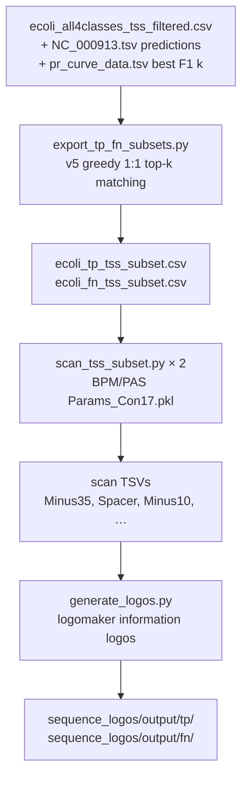

# PAS → logos: v5 O2O TP vs FN reference TSS (100 bp tol, best F1)

- **PAS/BPM:** runs only in `promoter_architecture_scan` (same BPM bundle as v4 type-1 class workflow).
- **Logos:** `sequence_logos` reads BPM output columns only; no neural scan.

Parent H-NS bar chart (unchanged): `bar_chart/generate_hns_bar_chart.py` uses the same matching rule for overlap plots; this folder reuses that definition in `matching_v5_o2o.py` for subsetting only.
